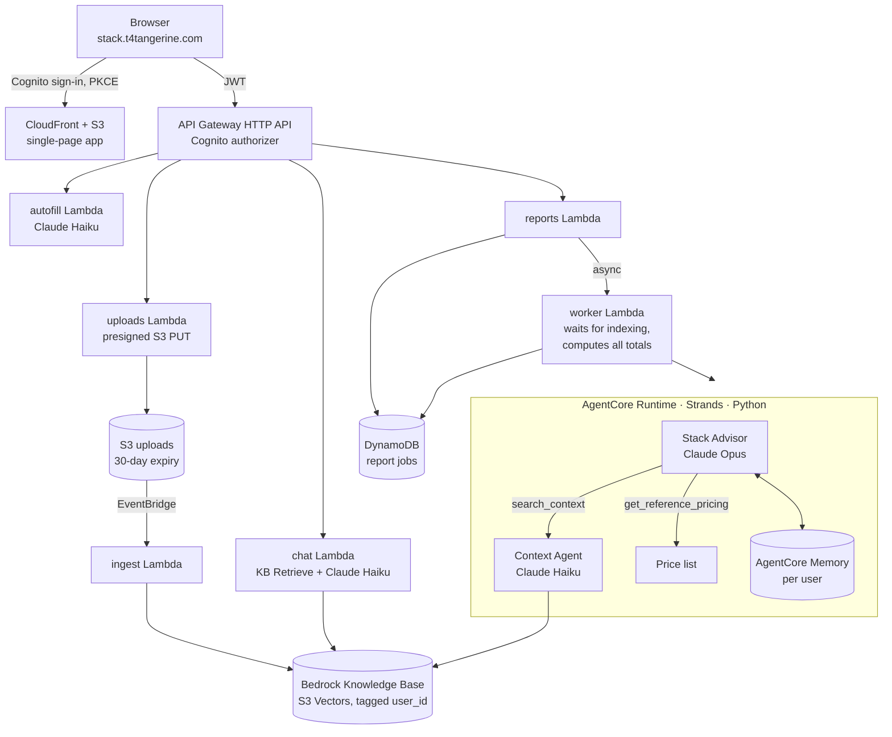

# Stack Optimizer

**A multi-agent AI app that tells a company where it overpays for software and cloud, and what to do about it, in plain language a VP can act on.**

Live: **[stack.t4tangerine.com](https://stack.t4tangerine.com)** (free account) · Built by [T4Tangerine](https://www.t4tangerine.com), Luxembourg

---

## The problem

Software and cloud bills grow quietly: tools that do the same job, seats nobody uses, plans and servers bigger than needed. The people who sign off the budget (founders, VPs of engineering) rarely have time to audit them, and cloud-pricing advice is usually written for specialists.

Stack Optimizer takes a company's tools and costs, plus its own documents (security policy, goals, contracts, card statements), and returns a tool-by-tool plan: **keep, cancel, downgrade, consolidate, switch, or move to AWS / Google Cloud**. Each recommendation comes with the monthly saving, the one-off cost of switching, the payback time, and how it respects the company's rules.

## What a user does

1. **Uploads files.** The form is pre-filled from them (tools, costs, team size, constraints).
2. **Chats with the Context Agent.** It answers questions about the files with citations and asks clarifying questions ("How many people actually use Figma?").
3. **Generates the report** (about 2 minutes). They can download it as a PDF, revisit it later, or delete it along with its files.

## Architecture



Everything runs in **one EU region (Frankfurt)**, with EU inference profiles for the models.

## The two agents

| Agent | Model | Role | Tools |
|---|---|---|---|
| **Stack Advisor** | Claude Opus | Orchestrator. Reviews every tool, decides the verdict, writes the plan. | `search_context`: asks the Context Agent a question<br/>`get_reference_pricing(category)`: AWS / GCP list prices<br/>AgentCore Memory: recalls and saves what it learned about the client<br/>Structured output: a schema-checked report |
| **Context Agent** | Claude Haiku | Retrieval specialist. Answers from the client's documents only, with citations. Also powers the chat panel. | Bedrock Knowledge Base retrieval, filtered to the signed-in user |

Form pre-fill is a single structured-output call, not an agent.

## Design decisions

- **The model judges, code calculates.** The Advisor estimates per-tool costs; every total, saving, payback period and per-person figure is computed deterministically ([`report-logic.ts`](infra/lambda/shared/report-logic.ts)). The AI summary is not allowed to quote totals, so text and numbers can't disagree.
- **Schema-checked output.** The report must match a fixed structure ([`report_model.py`](agents/src/report_model.py)), so the page always gets valid data.
- **Grounded prices.** AWS and Google Cloud estimates come from a price list via a tool, not from the model's memory.
- **The client's rules win.** Hard constraints in their documents (EU-only data, approved vendors) override cost. A cloud ruled out by policy is shown as "Not an option", never as a saving.
- **Tenant isolation.** The `user_id` used for retrieval and memory comes from the Cognito token via the worker, never from the model, so one user's agent can't see another user's documents or memories.
- **Deletion means deletion.** Deleting a report removes its S3 files and their Knowledge Base entries. The worker's final write is conditional, so a report deleted mid-run doesn't come back.
- **Plain language by design.** Prompts target a VP reader: no unexplained acronyms, instance types or region codes, and every recommendation says what it saves, what it costs and how hard it is.
- **Two deployments, one code base.** The same page and shared logic ([`lib/stack-optimizer`](lib/stack-optimizer)) ran as a public no-account version (Vercel + Claude API, [`api/`](api)) and as the signed-in AWS app.

## Lessons from production

- **A silent indexing failure.** Every upload had failed to index since launch: a missing `bedrock:StartIngestionJob` permission, and an S3 data source that only accepts metadata as a sidecar file. Reports listed file names but never read them. Fixed, re-indexed, and the worker now treats "not registered yet" files correctly.
- **Text and numbers disagreed.** A real report showed €7,827/month in the KPIs and €5,590 in the summary. The causes were duplicate rows remembered by the form and an AI summary computing its own totals. Fixes: a duplicate-tool warning in the form, and the summary no longer quotes totals.
- **Output limits.** A 22-tool report exceeded 16k output tokens; the Advisor now streams with a 32k limit.
- **Leaky internals.** The model referred to rows as "item [27]". References are now rewritten as tool names, both when the report is built and when an older report is displayed.

## Evaluation plan

Each component is scored separately against fictional test companies with answer keys:

| Component | What is measured |
|---|---|
| Pre-fill | Share of tools found, share that are real, cost within ±5%, team size exact |
| Context Agent | Right passage in the top 5 (and its rank), answer correctness, grounding, citation accuracy, says "not found" when it should |
| Stack Advisor | Code checks (policy breaches, coverage, totals, savings range, citations, jargon) plus an LLM-graded rubric; compared across Opus, Sonnet and Haiku on quality, cost and time |

In production today: per-turn chat logs (passages, latency, tokens; no message text). Next: AgentCore tracing of the Advisor's questions, and 👍/👎 feedback on reports.

## Repository map

```
agents/         Stack Advisor + Context Agent (Strands, AgentCore Runtime), tests
infra/          AWS CDK app: Auth, Data, Agent, Api, Cert, Web, Ops stacks + Lambda handlers
lib/stack-optimizer/   Logic shared by both deployments: chat prompt, pre-fill, pricing, retrieval
api/            Public (Vercel) version of the report, pre-fill and chat endpoints
stack/          The single-page app (form, chat panel, report, PDF export)
```

Setup and deployment: see [`infra/README.md`](infra/README.md).

## Tech

AWS CDK (TypeScript) · Amazon Bedrock (Claude Opus and Haiku, Knowledge Bases, S3 Vectors) · Bedrock AgentCore (Runtime, Memory) · Strands Agents (Python) · Lambda · API Gateway · Cognito · DynamoDB · S3 · CloudFront · EventBridge · Claude API · Vercel

---

© 2026 T4Tangerine. All rights reserved. This code is published for viewing only; see [LICENSE](LICENSE).
