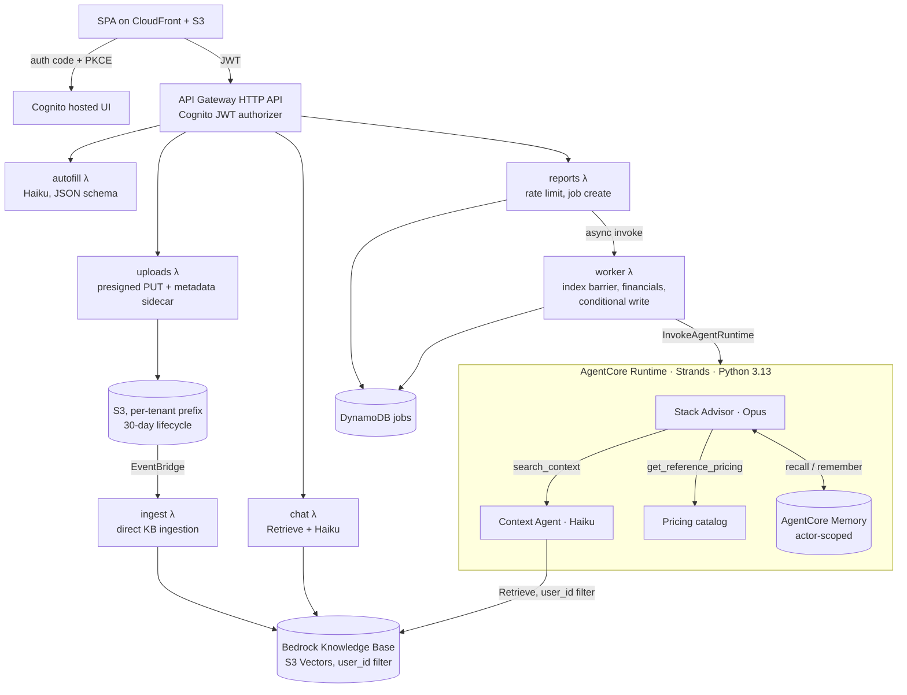

# Stack Optimizer

**Multi-agent system that audits a company's software and cloud spend against its own policies and returns a tool-by-tool cost plan, with deterministic financials.** Built for founders, CTOs, technical advisors and VPs of Engineering.

Live: **[stack.t4tangerine.com](https://stack.t4tangerine.com)** · Built by [T4Tangerine](https://www.t4tangerine.com)

---

## What it does

Input: the company's tools and monthly costs, team size (now and in 12 months), priorities, and its own documents: security policy, company goals, procurement SOPs, contracts, card statements.

Output: a structured plan with one verdict per tool, `keep | cancel | downgrade | consolidate | switch | aws | gcp`, each carrying:
- the monthly saving,
- the one-off switching cost and effort,
- the payback period,
- risks and a phased roadmap,
- citations to the documents that constrained the decision.

Hard constraints in the documents (data residency, approved-vendor lists) override cost.

Three stages:
1. **Ingest and pre-fill.** Files are indexed per tenant. A structured-output call extracts tools, costs, team size and constraints into the form.
2. **Clarify.** A chat with the Context Agent: grounded Q&A over the tenant's documents, plus targeted clarifying questions. The transcript is passed to the Advisor as client-asserted facts.
3. **Plan.** An async job runs the Stack Advisor: tool use, a schema-validated report, and server-side arithmetic.

## Architecture



Single region (eu-central-1) with EU cross-region inference profiles, so data and inference stay in the EU. Seven CDK stacks: Auth, Data, Agent, Api, Cert, Web, Ops.

## Agents and tools

| | Stack Advisor | Context Agent |
|---|---|---|
| Model | Claude Opus | Claude Haiku |
| Role | Orchestrator. Plans the review, calls tools, emits the report | Retrieval specialist. Answers only from retrieved passages, with citations; says "not found" otherwise |
| Tools | `search_context(question)` → Context Agent<br/>`get_reference_pricing(category)` → AWS/GCP list prices<br/>AgentCore Memory `recall`/`remember` | Bedrock KB `Retrieve`, metadata-filtered to the caller's `user_id` |
| Output | Pydantic `StackReport` (structured output) | Short grounded answer with excerpt ids |

The Advisor decides when, and how often, to query the Context Agent. Typical questions are about residency rules, approved vendors, budget targets, contract renewal dates and SLAs. Running the two agents in one runtime keeps the hop in-process, and the model split keeps retrieval cheap.

## Engineering decisions

**LLM judgement, code arithmetic**
- The Advisor returns per-tool estimates only. All totals, savings, payback, net savings over the planning horizon and per-person costs are computed in [`report-logic.ts`](infra/lambda/shared/report-logic.ts).
- The executive summary is prohibited from quoting totals, so prose and numbers can't diverge.
- The verdict is recomputed in code when it's inconsistent. For example, a cloud recommendation with no service named, or a cloud ruled out by policy, falls back to `keep`.

**Grounding**
- Cloud prices come from a versioned pricing catalog through a tool, not from model priors.
- Client documents are reachable only through retrieval with citations.
- Chat answers are explicitly treated as client-asserted facts. Document constraints still win over them.

**Tenant isolation**
- `user_id` is taken from the Cognito JWT in the Lambda and passed to the runtime. It is never a model-controlled argument.
- KB retrieval and AgentCore Memory namespaces are both scoped by it. S3 keys are prefixed per tenant, and the report API validates that every document key belongs to the caller.

**Async jobs with an indexing barrier**
- `POST /reports` creates a `PENDING` job, applies a daily quota, and invokes the worker asynchronously.
- The worker waits until each attached document is `INDEXED` in the KB, treating `NOT_FOUND` as "not registered yet", and only then invokes the runtime.

**Deletion is real, and race-safe**
- `DELETE /reports/{id}` removes the report's S3 objects (unless another report shares them), and an EventBridge-driven handler deletes the matching KB documents.
- It leaves a content-free tombstone with a TTL, so deleted reports still count toward the quota.
- The worker's final write is conditional (`attribute_exists AND status <> DELETED`), so a job deleted mid-run can't be resurrected.

**Output robustness**
- The Advisor streams with a 32k output budget; 22-tool reports exceeded 16k.
- Internal row references the model sometimes emits ("item [27]") are rewritten to tool names, both server-side at build time and client-side at render time, so stored reports are fixed too.

**Least privilege, EU-only**
- Scoped IAM per function. Bedrock access is limited to the configured EU inference profiles and their underlying models.
- CloudFront serves with security headers and a strict CSP.
- Uploads expire after 30 days, and a budget alarm covers all resources tagged with the app name.

**One codebase, two deployment targets**
- The same SPA and shared modules ([`lib/stack-optimizer`](lib/stack-optimizer)) run as a public, no-account version (Vercel + Claude API with in-memory BM25 retrieval, [`api/`](api)) and as the authenticated AWS deployment.
- The page switches to app mode based on hostname.

## Production incidents and fixes

| Symptom | Root cause | Fix |
|---|---|---|
| Reports cited file names but never their contents | Every KB ingestion had failed since launch: missing `bedrock:StartIngestionJob`, and an S3 data source rejects inline metadata (it needs an `S3_LOCATION` sidecar) | IAM fix, sidecar written at upload time, `NOT_FOUND` handled in the indexing barrier, selective re-index of the latest set to avoid duplicate passages |
| KPI showed €7,827/mo, summary said €5,590 | Duplicate rows persisted from an earlier session, plus the model computing its own totals in prose | Client-side duplicate detection with one-click removal; summary barred from quoting totals |
| "Save 100%" on Google Cloud for every infra row | Policy excluded GCP; the model returned `0` with no service | An option without a named service is treated as unavailable: costed at today's price, rendered "Not an option", hidden from the comparison chart |
| `max_tokens` failures on large stacks | 22-tool reports exceeded the 16k output budget | Streaming with a 32k budget |
| "item [27]" leaking into client-facing text | Model referencing input indices | Deterministic rewrite to tool names (build and render time) |

## Evaluation

Components are evaluated independently against synthetic companies with answer keys. For example, "Nordlicht Analytics" (six documents; about €28.6k/yr of expected savings). Fixtures are not included in this repo.

| Component | Metrics |
|---|---|
| Pre-fill | Tool recall and precision, cost within ±5%, team size exact match |
| Context Agent | Retrieval hit@5 and rank of the gold passage; answer correctness; groundedness; citation precision; correct abstention |
| Stack Advisor | Programmatic checks: policy violations, one verdict per input row, arithmetic consistency, savings within an expected band, citation validity, jargon lint. Plus an LLM-graded rubric. Compared across Opus, Sonnet and Haiku on quality, cost and latency |

**Observability:** structured per-turn chat logs (passage count, latency, tokens; no message content). Next: AgentCore tracing of the Advisor's tool calls, and report-level feedback.

**Typical latency:** about 2–3 minutes for a full report with 20+ tools.

## Repository map

```
agents/                Stack Advisor + Context Agent (Strands on AgentCore Runtime), Pydantic report model, tests
infra/                 AWS CDK app (7 stacks) and Lambda handlers: uploads, ingest, autofill, chat, reports, worker
lib/stack-optimizer/   Shared by both targets: chat prompt and request handling, pre-fill schema, pricing catalog, BM25 retrieval, reference cleanup
api/                   Public target: report, pre-fill and chat endpoints on Vercel + Claude API
stack/                 The SPA: form, chat panel, report rendering, client-side PDF export
```

Setup and deployment: [`infra/README.md`](infra/README.md).

## Stack

AWS CDK (TypeScript) · Amazon Bedrock (Claude Opus and Haiku, Knowledge Bases, S3 Vectors) · Bedrock AgentCore (Runtime, Memory) · Strands Agents (Python) · Lambda · API Gateway HTTP API · Cognito · DynamoDB · S3 · CloudFront · EventBridge · Claude API · Vercel

---

© 2026 T4Tangerine. All rights reserved. Published for viewing only; see [LICENSE](LICENSE).
